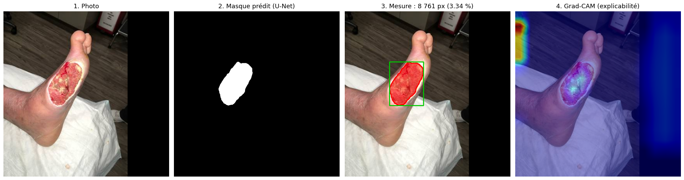
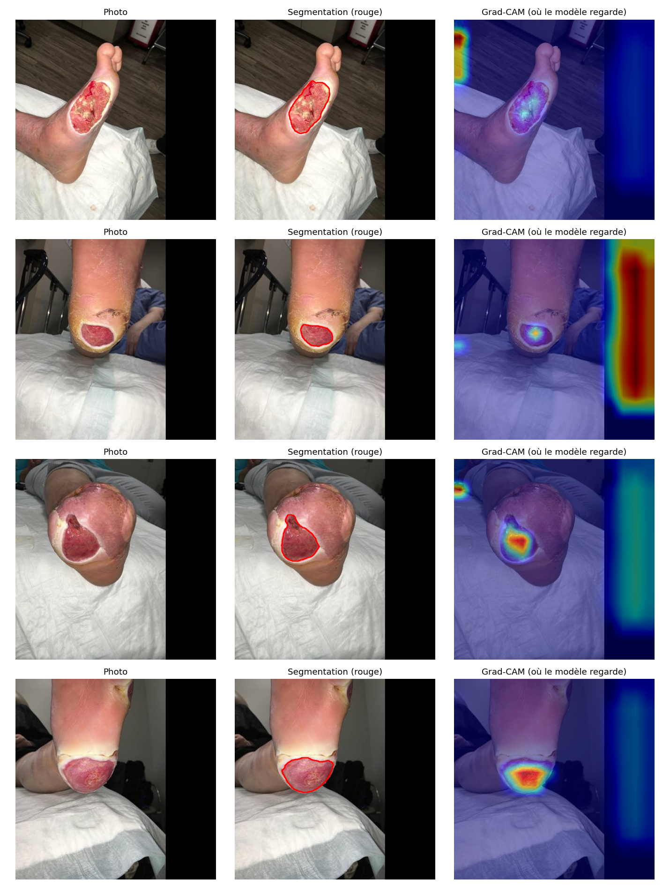

# 🩹 Wound-AI Mini

Segmentation automatique de plaies sur photo avec un **U-Net**, mesure de leur surface avec **OpenCV** et explicabilité avec **Grad-CAM**, servies par une **API FastAPI** avec une **démo Streamlit** et une image **Docker**.

> ⚠️ Projet de démonstration à but pédagogique. Ce n'est **pas** un dispositif médical.



---

## 📊 Résultats

U-Net (encodeur ResNet34 pré-entraîné ImageNet) entraîné sur le dataset **FUSeg** (ulcères du pied diabétique), évalué sur le **jeu de validation (200 images)** :

| Métrique | Valeur |
|---|---|
| **Dice moyen** | **0.849** |
| IoU moyen | 0.774 |
| Dice (images avec plaie) | 0.865 |
| Précision (pixels) | 0.929 |
| Rappel (pixels) | 0.904 |

<p align="center">
  
</p>

Exemples réussis et ratés (vert = vrai masque, rouge = prédiction) :


---

## 🏗️ Architecture

```
Photo ──► Prétraitement ──► U-Net ResNet34 ──► Masque ──► Mesure OpenCV ──► Surface, contours, cadre
          (512×512,          (1 classe :         (seuil      (aire px / %,
           normalisation      plaie / fond)       0.5)        périmètre, bbox)
           ImageNet)                │
                                    └──► Grad-CAM (3e bloc du décodeur) ──► Carte de chaleur

API FastAPI  : POST /predict  ──►  mesures + images (base64)
Démo         : Streamlit  ──►  appelle l'API
Déploiement  : Docker (API + modèle)
```

| Fichier | Rôle |
|---|---|
| `notebooks/train_unet.ipynb` | Dataset, augmentations, entraînement et évaluation (Google Colab, GPU T4) |
| `src/predict.py` | Chargement du modèle et prédiction du masque |
| `src/measure.py` | Mesure de la plaie (surface, périmètre, cadre) et image de superposition |
| `src/gradcam.py` | Carte d'explicabilité Grad-CAM |
| `api/main.py` | API FastAPI (`/health`, `/predict`) |
| `demo/app.py` | Interface Streamlit |
| `Dockerfile` | Image Docker de l'API |

### Entraînement

| Paramètre | Valeur |
|---|---|
| Modèle | U-Net, encodeur ResNet34 (`segmentation-models-pytorch`) |
| Entrée | 512 × 512, normalisation ImageNet |
| Perte | Dice + BCE |
| Optimiseur | Adam, lr = 1e-4, réduit de moitié si le Dice stagne |
| Époques | 30 (meilleur modèle selon le Dice de validation) |
| Augmentations | Flips, rotations 90°, luminosité / contraste |
| Matériel | Google Colab, GPU T4, précision mixte |

---

## 🚀 Lancer le projet

### 1. Installation

```bash
git clone https://github.com/AmenAllahAddali/wound-ai-mini.git
cd wound-ai-mini
python -m venv venv
# Windows : .\venv\Scripts\Activate.ps1   |   Linux / macOS : source venv/bin/activate
pip install -r requirements.txt
```

### 2. Télécharger le modèle entraîné

Le modèle (~98 Mo) n'est pas dans le dépôt. Téléchargez `best_unet.pth` depuis la [Release v0.1-model](https://github.com/AmenAllahAddali/wound-ai-mini/releases) et placez-le dans `models/best_unet.pth`.

### 3. Lancer l'API puis la démo

```bash
uvicorn api.main:app --port 8000      # terminal 1 → http://localhost:8000/docs
streamlit run demo/app.py             # terminal 2 → http://localhost:8501
```

### Avec Docker

```bash
docker build -t wound-ai-mini .        # nécessite models/best_unet.pth
docker run --rm -p 8000:8000 wound-ai-mini
```

La démo Streamlit fonctionne sans changement avec l'API dans le conteneur.

### Utiliser l'API

```bash
curl http://localhost:8000/health
curl -X POST -F "file=@photo.png" "http://localhost:8000/predict?explain=true"
```

Paramètres de `/predict` : `threshold` (seuil, défaut 0.5), `px_per_cm` (pour obtenir des cm²), `explain` (ajoute le Grad-CAM).

Réponse (extrait) :

```json
{
  "measurements": {
    "wound_detected": true,
    "area_px": 9913,
    "area_percent": 3.78,
    "regions": 1,
    "perimeter_px": 464.9,
    "bbox": [284, 155, 110, 144]
  },
  "mean_confidence": 0.99,
  "overlay_png_base64": "...",
  "mask_png_base64": "...",
  "gradcam_png_base64": "..."
}
```

---

## 🔍 Explicabilité (Grad-CAM)



- **v1** : Grad-CAM sur le dernier bloc de l'encodeur (grille 16 × 16). Correct sur les grandes plaies, mais **ratait les petites plaies** et réagissait aux bords de l'image.
- **v2** : Grad-CAM sur le **3e bloc du décodeur** (grille 128 × 128) et bandes noires de remplissage ignorées. La carte se concentre désormais sur la plaie, y compris quand elle est petite.

---

## ⚠️ Limites

- **Un seul type de plaie** : le modèle n'a vu que des ulcères du pied (FUSeg). Il n'est pas validé sur d'autres plaies (brûlures, plaies chirurgicales…).
- **Surface en pixels** : sans repère de taille connue sur la photo, la surface ne peut pas être convertie en cm². Le paramètre `px_per_cm` est prévu pour ça.
- **Petites plaies peu contrastées** : le modèle peut sous-segmenter (ex. image de validation `0017.png` : seul le centre de la plaie est détecté).
- **Faux positifs** : sur les images sans plaie, le modèle détecte parfois de petites zones (le Dice des images avec plaie, 0.865, est plus élevé que le Dice moyen, 0.849).
- **Grad-CAM** : de petites activations parasites peuvent subsister sur les bords de l'image. La carte sert à vérifier que le modèle s'appuie sur la plaie, pas à la délimiter.
- **Évaluation** : uniquement sur le jeu de validation (les masques du jeu de test du challenge ne sont pas publics).

## 🔭 Améliorations prévues

- Détection avec **YOLO** et classification du **type de plaie** (ViT)
- **Suivi de la cicatrisation** dans le temps (comparaison de photos successives)
- Conversion en **cm²** avec un marqueur de calibration sur la photo
- Application mobile **Flutter** connectée à l'API

---

## 📚 Données

**FUSeg — Foot Ulcer Segmentation Challenge** (University of Wisconsin-Milwaukee, AZH Wound Center) : [dépôt GitHub](https://github.com/uwm-bigdata/wound-segmentation) · [article](https://arxiv.org/abs/2201.00414). Les images ne sont pas redistribuées dans ce dépôt.

## 👥 Auteurs

- **Aya Chokri** — dataset, entraînement et évaluation du modèle, Grad-CAM · [github.com/ayaachokri](https://github.com/ayaachokri)
- **Amen Allah Addali** — inférence, mesure OpenCV, API FastAPI, démo Streamlit, Docker · [github.com/AmenAllahAddali](https://github.com/AmenAllahAddali)

Étudiants en 3ᵉ année GLSI — Institut Supérieur d'Informatique de Mahdia (ISIMa).
